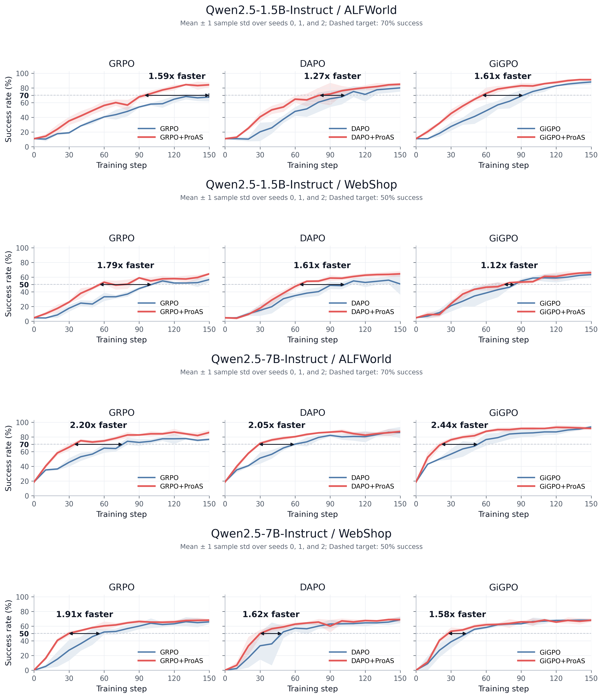
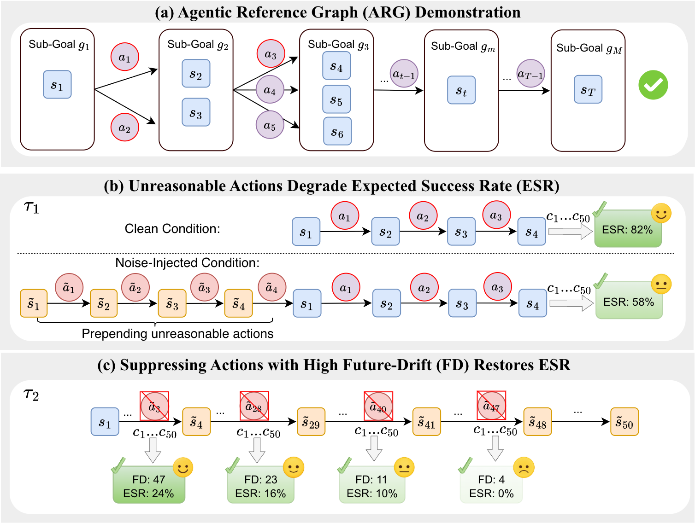

<div align="center">

<h1>ProAS: A Progress-Aware Advantage Shaping Framework For Multi-Turn Agentic Reinforcement Learning</h1>

<p><em>Calibrating the Credit Assignment of Group-base RL Algorithms for Effective and Efficient Agentic Training.</em></p>

<p align="center">
        📑 <a href="https://arxiv.org/abs/2610.18683">Paper</a> &nbsp&nbsp 
</p>

<p>
  
</p>

</div>

---

## 📚 Contents

- [Introduction](#introduction)
  - [Motivation](#motivation)
  - [Method](#method)
- [Getting Started](#getting-started)
  - [ALFWorld](#1-alfworld)
  - [WebShop](#2-webshop)
  - [Verl](#3-verl)
- [Usage](#usage)
  - [Data](#data)
  - [Models](#models)
  - [Codes](#codes)
- [Results](#results)
  - [Main Results](#main-results)
  - [Ablation Study](#ablation-study)
- [Acknowledgements](#acknowledgements)

---
<a id="introduction"></a>

## 📖 Introduction
Group-based RL algorithms such as GRPO and DAPO assign the same advantage to every step of a trajectory. This **uniform credit assignment** reinforces unreasonable actions in successful trajectories and penalizes every action in a failed trajectory equally, regardless of how much it contributed to the failure. **ProAS** (**Pro**gress-Aware **A**dvantage **S**haping) calibrates this credit with step-level progress signals from a dynamically evolving **Agentic Reference Graph (ARG)**.

<a id="motivation"></a>

### Motivation
Two findings on GRPO with Qwen2.5-1.5B-Instruct:

- **Unreasonable actions get reinforced, and they hurt.** Unreasonable actions, i.e., actions that make an invalid state transition such as an explicit error, make up 41.6% / 39.6% of *successful* trajectories on ALFWorld / WebShop. Injecting a 4-step unreasonable segment into a clean ALFWorld context drops the expected success rate (ESR) from **82% to 58%** (panel (b) below).
- **Uniform penalties overlook how much each step drifts the trajectory.** Non-advancing (NA) actions, i.e., actions that fail to reach a new valid state, dominate *failed* trajectories (93.1% / 76.1%), and late ones are often fallout from an already polluted context. We measure this with **Future-Drift (FD)**, the number of NA actions from step $t$ to the end of trajectory $\tau_i$: $\mathcal{D}_{i,t} = \sum_{t'=t}^{\lvert\tau_i\rvert} (1 - \text{PA}_{i,t'})$, where $\text{PA}_{i,t'} = 0$ marks an NA step. Suppressing actions with FD = 47 / 23 / 11 / 4 recovers ESR of **24% / 16% / 10% / 0%** (panel (c) below), so high-FD actions should be suppressed first.

<p align="center">
  
</p>
<p align="center"><sub>
<b>(a) The demonstration of ARG.</b> Diverse successful trajectories are unified into a DAG that serves as a progress reference.
<b>(b) Probing unreasonable actions.</b> From an identical state, the counterpart injected with unreasonable actions yields a lower Expected Success Rate (ESR) on 50 sampled continuations.
<b>(c) Suppressing by Future-Drift (FD).</b> Forcibly suppressing the original action at different trajectory points and resampling 50 continuations shows recovered ESR rises with the suppressed action's FD.
</sub></p>

### Method
ProAS reshapes the trajectory-level advantage $A_i$ into a step-level advantage $\tilde{A}_{i,t}$:

```math
\tilde{A}_{i,t} =
\begin{cases}
\text{Rea}_{t} \cdot A_i, & \text{if } A_i > 0 \quad \text{(MUI)}, \\
\dfrac{\mathcal{D}_{i,t}}{\bar{\mathcal{D}}_i + \epsilon} \cdot A_i, & \text{if } A_i < 0 \text{ and } t \in \mathcal{T} \quad \text{(APR)}, \\
A_i, & \text{otherwise.}
\end{cases}
```

- **Masking Unreasonable Incentives (MUI):** in preferred trajectories ($A_i > 0$), unreasonable steps ($\text{Rea}_t = 0$) get zero advantage, so they are no longer reinforced.
- **Asymmetric Penalty Redistribution (APR):** in unpreferred trajectories ($A_i < 0$), each step's penalty is scaled by its Future-Drift $\mathcal{D}_{i,t}$ relative to the mean $\bar{\mathcal{D}}_i$ over the uniformly credited steps $\mathcal{T}$, so early actions are penalized more than late, context-induced ones.

---
<a id="getting-started"></a>

## ✨ Getting Started
ProAS is built on top of [verl-agent](verl-agent/README.md). Before training, set up the two agent environments below, ALFWorld and WebShop.

> ⚠️ **Important:** Each environment must be installed and configured before an agent can run in it. To avoid package version conflicts, we recommend giving ***each environment its own conda environment***.

### 1. ALFWorld
Install the dependencies:
```bash
pip3 install gymnasium==0.29.1
pip3 install stable-baselines3==2.6.0
pip install alfworld
```

Fetch the PDDL and game files together with the pre-trained MaskRCNN detector, which are saved to `~/.cache/alfworld/`. Add `--extra` if you also need the pre-trained checkpoints and seq2seq data.
```bash
alfworld-download -f
```

To check the installation, launch an interactive TextWorld game:
```bash
alfworld-play-tw
```

### 2. WebShop
WebShop needs Python 3.10 or lower, so create a dedicated environment first:
```bash
conda create -n verl-agent-webshop python==3.10 -y
conda activate verl-agent-webshop
```

Run the WebShop setup script from the repository root:
```bash
cd verl-agent/agent_system/environments/env_package/webshop/webshop
./setup.sh -d all
```

> If `gdown` fails to download the data, copy your Google Drive cookie from https://drive.google.com/ into `~/.cache/gdown/cookies.txt`, or download the files manually.


### 3. Verl
Then go back to `verl-agent/` and install verl together with its dependencies:
```bash
cd ../../../../..   # back to verl-agent/
pip3 install torch==2.6.0 --index-url https://download.pytorch.org/whl/cu124
pip3 install flash-attn==2.7.4.post1 --no-build-isolation
pip3 install -e .
pip3 install vllm==0.8.2
```

pip may report that `spacy` and `weasel` require `typer<0.10.0` while `typer 0.15.2` is installed. These conflicts are harmless and can be ignored.

---

## 🔧 Usage
We adopt the non-intrusive development on the verl-agent for ProAS. Data, models, codes, and scripts are saved in seperate folders.

### Data
All fixed task data lives under `verl-agent/recipe/graph_guide/data/`. We train for 150 steps with 16 tasks per step for group-based methods and 128 task slots per step for PPO, and validate on 128 tasks every 10 steps. To make runs reproducible, both the training tasks and the validation tasks are fixed in advance:

- **[`verl-agent/recipe/graph_guide/data/fixed_train_set/`](verl-agent/recipe/graph_guide/data/fixed_train_set/README.md)** holds training schedules for `seed{0,1,2}/{alfworld,webshop}`. Each `schedule.jsonl` lists the 16 tasks for each of the 150 steps, taken from the official GRPO rollouts in the same order. Each `manifest.json` records where the schedule came from, its file hashes, and a check that it shares no tasks with the validation set. Enable a schedule with `env.fixed_train_set.path=recipe/graph_guide/data/fixed_train_set/seed0/alfworld`; if the option is left unset, training samples tasks online as before.
- **[`verl-agent/recipe/graph_guide/data/fix_train_set_ppo/`](verl-agent/recipe/graph_guide/data/fix_train_set_ppo/README.md)** holds the PPO schedules for the same seeds and environments, with 150 batches of 128 task slots. Enable a PPO schedule with `env.fixed_train_set.path=recipe/graph_guide/data/fix_train_set_ppo/seed0/alfworld`.
- **[`verl-agent/recipe/graph_guide/data/fixed_val_set/`](verl-agent/recipe/graph_guide/data/fixed_val_set/README.md)** holds 128 unique validation tasks per environment, none of which appear in training. ALFWorld tasks come from the official `valid_seen` split (`alfworld.jsonl`, `alfworld_gamefiles.txt`); WebShop tasks come from the benchmark's evaluation range `[500, 1500)` (`webshop.jsonl`). Enable it with `env.fixed_val_set.enabled=true` and keep `data.val_batch_size=128`. The default validation root is `recipe/graph_guide/data/fixed_val_set`, relative to `verl-agent/`.

### Models
Our experiments are performed on Qwen2.5-1.5B-Instruct and Qwen2.5-7B-Instruct. Download these models to [verl-agent/recipe/graph_guide/models](verl-agent/recipe/graph_guide/models) from huggingface:

- [Qwen2.5-1.5B-Instruct](https://huggingface.co/Qwen/Qwen2.5-1.5B-Instruct)

- [Qwen2.5-7B-Instuct](https://huggingface.co/Qwen/Qwen2.5-7B-Instruct)


### Codes
ProAS is implemented as a single recipe, [`verl-agent/recipe/graph_guide/`](verl-agent/recipe/graph_guide/README.md). It hooks into the verl-agent trainer without changing the PPO loop: the base estimator computes advantages as usual, and ProAS then reshapes them with ARG annotations. Each part of the recipe has its own README:

- [`graph_guide/`](verl-agent/recipe/graph_guide/README.md): Training entry points and the core credit module, `graph_guide_credit.py`, which annotates every step against the ARG and applies MUI and APR. The README also maps the paper's notation to the code.
- [`graph_guide/oracle_build/`](verl-agent/recipe/graph_guide/oracle_build/README.md): ARG construction and environment adapters for ALFWorld and WebShop, plus the prebuilt graphs, including the *Incomplete* and *Distill* variants.
- [`graph_guide/run_sh_fair/`](verl-agent/recipe/graph_guide/run_sh_fair/README.md): Launchers for ProAS, the RL baselines, and every ablation, organized by model size, seed, and environment.
- [`graph_guide/sft_baseline/`](verl-agent/recipe/graph_guide/sft_baseline/README.md): SFT baseline trained on oracle trajectories of the same training tasks.
- [`graph_guide/react_infer/`](verl-agent/recipe/graph_guide/react_infer/README.md): ReAct prompting baseline with a proprietary API model on the fixed validation set.

Outside the recipe, the fixed training and validation sets are loaded by `verl-agent/agent_system/environments/fixed_training.py` and `fixed_validation.py`, and the MiGPO baseline lives in `verl-agent/recipe/migpo/`.

<a id="results"></a>

## 📈 Results
All results are the mean ± std over seeds 0/1/2, taken from the best validation checkpoint within 150 RL steps. ALFWorld reports success rate (SR, %) per task type and overall; WebShop reports task score (TS) and SR. **Spd.@K** is the speedup of ProAS over its base algorithm, measured as the ratio of RL training steps each needs to first reach K% SR (K = 70 for ALFWorld, 50 for WebShop).

### Main Results
ProAS improves the overall ALFWorld SR and the WebShop TS of GRPO, DAPO, and GiGPO at both model sizes, and reaches the target SR 1.1×–2.4× faster. The best results are 94.3% SR on ALFWorld (GiGPO+ProAS, 7B) and 70.8% SR on WebShop (GRPO+ProAS, 7B).

<table style="border-top:1px solid #888; border-bottom:1px solid #888">
<thead>
<tr><th rowspan="2" align="left" style="text-align:left">Method</th><th colspan="8" align="center" style="text-align:center">ALFWorld</th><th colspan="3" align="center" style="text-align:center; border-left:1px solid #888">WebShop</th></tr>
<tr><th align="center" style="text-align:center">Pick</th><th align="center" style="text-align:center">Look</th><th align="center" style="text-align:center">Clean</th><th align="center" style="text-align:center">Heat</th><th align="center" style="text-align:center">Cool</th><th align="center" style="text-align:center">Pick2</th><th align="center" style="text-align:center">All</th><th align="center" style="text-align:center">Spd.@70</th><th align="center" style="text-align:center; border-left:1px solid #888">TS</th><th align="center" style="text-align:center">SR</th><th align="center" style="text-align:center">Spd.@50</th></tr>
</thead>
<tbody>
<tr><td colspan="12"><i>Proprietary Model</i></td></tr>
<tr><td style="white-space:nowrap">GPT-5.6-Sol (ReAct)</td><td align="center" style="text-align:center">90.9</td><td align="center" style="text-align:center">83.3</td><td align="center" style="text-align:center">68.0</td><td align="center" style="text-align:center">83.3</td><td align="center" style="text-align:center">79.2</td><td align="center" style="text-align:center">68.2</td><td align="center" style="text-align:center">78.9</td><td align="center" style="text-align:center">–</td><td align="center" style="text-align:center; border-left:1px solid #888">27.6</td><td align="center" style="text-align:center">21.9</td><td align="center" style="text-align:center">–</td></tr>
<tr><td colspan="12"><i>Qwen2.5-1.5B-Instruct</i></td></tr>
<tr><td style="white-space:nowrap">Direct Prompt</td><td align="center" style="text-align:center">24.2<sub>±0.0</sub></td><td align="center" style="text-align:center">25.0<sub>±0.0</sub></td><td align="center" style="text-align:center">4.0<sub>±0.0</sub></td><td align="center" style="text-align:center">8.3<sub>±0.0</sub></td><td align="center" style="text-align:center">0.0<sub>±0.0</sub></td><td align="center" style="text-align:center">4.5<sub>±0.0</sub></td><td align="center" style="text-align:center">10.9<sub>±0.0</sub></td><td align="center" style="text-align:center">–</td><td align="center" style="text-align:center; border-left:1px solid #888">25.3<sub>±0.0</sub></td><td align="center" style="text-align:center">4.7<sub>±0.0</sub></td><td align="center" style="text-align:center">–</td></tr>
<tr><td style="white-space:nowrap">SFT</td><td align="center" style="text-align:center">99.0<sub>±1.7</sub><sup>*</sup></td><td align="center" style="text-align:center">91.7<sub>±8.3</sub></td><td align="center" style="text-align:center">94.7<sub>±2.3</sub></td><td align="center" style="text-align:center">100.0<sub>±0.0</sub><sup>*</sup></td><td align="center" style="text-align:center">93.1<sub>±2.4</sub><sup>*</sup></td><td align="center" style="text-align:center">1.5<sub>±2.6</sub></td><td align="center" style="text-align:center">79.7<sub>±0.8</sub></td><td align="center" style="text-align:center">–</td><td align="center" style="text-align:center; border-left:1px solid #888">78.2<sub>±1.7</sub></td><td align="center" style="text-align:center">64.3<sub>±3.0</sub></td><td align="center" style="text-align:center">–</td></tr>
<tr><td style="white-space:nowrap">PPO</td><td align="center" style="text-align:center">82.8<sub>±7.6</sub></td><td align="center" style="text-align:center">58.3<sub>±8.3</sub></td><td align="center" style="text-align:center">80.0<sub>±4.0</sub></td><td align="center" style="text-align:center">75.0<sub>±8.3</sub></td><td align="center" style="text-align:center">76.4<sub>±6.4</sub></td><td align="center" style="text-align:center">54.5<sub>±9.1</sub></td><td align="center" style="text-align:center">73.2<sub>±4.3</sub></td><td align="center" style="text-align:center">–</td><td align="center" style="text-align:center; border-left:1px solid #888">75.3<sub>±11.1</sub></td><td align="center" style="text-align:center">55.2<sub>±6.6</sub></td><td align="center" style="text-align:center">–</td></tr>
<tr><td style="white-space:nowrap">MiGPO</td><td align="center" style="text-align:center">97.0<sub>±3.0</sub></td><td align="center" style="text-align:center">91.7<sub>±0.0</sub></td><td align="center" style="text-align:center">98.7<sub>±2.3</sub><sup>*</sup></td><td align="center" style="text-align:center">100.0<sub>±0.0</sub><sup>*</sup></td><td align="center" style="text-align:center">84.7<sub>±6.4</sub></td><td align="center" style="text-align:center">75.8<sub>±2.6</sub></td><td align="center" style="text-align:center">91.1<sub>±1.6</sub></td><td align="center" style="text-align:center">–</td><td align="center" style="text-align:center; border-left:1px solid #888">79.5<sub>±1.2</sub></td><td align="center" style="text-align:center">53.6<sub>±1.8</sub></td><td align="center" style="text-align:center">–</td></tr>
<tr><td style="white-space:nowrap">GRPO</td><td align="center" style="text-align:center">80.8<sub>±4.6</sub></td><td align="center" style="text-align:center">69.4<sub>±4.8</sub></td><td align="center" style="text-align:center">70.7<sub>±6.1</sub></td><td align="center" style="text-align:center">75.0<sub>±8.3</sub></td><td align="center" style="text-align:center">63.9<sub>±9.6</sub></td><td align="center" style="text-align:center">59.1<sub>±9.1</sub></td><td align="center" style="text-align:center">70.3<sub>±2.8</sub></td><td align="center" style="text-align:center">–</td><td align="center" style="text-align:center; border-left:1px solid #888">82.4<sub>±1.3</sub></td><td align="center" style="text-align:center">57.0<sub>±3.1</sub></td><td align="center" style="text-align:center">–</td></tr>
<tr><td style="white-space:nowrap">GRPO+<b>ProAS</b></td><td align="center" style="text-align:center"><b>90.9<sub>±5.2</sub></b></td><td align="center" style="text-align:center"><b>86.1<sub>±4.8</sub></b></td><td align="center" style="text-align:center"><b>90.7<sub>±2.3</sub></b></td><td align="center" style="text-align:center"><b>91.7<sub>±8.3</sub></b></td><td align="center" style="text-align:center"><b>83.3<sub>±4.2</sub></b></td><td align="center" style="text-align:center"><b>78.8<sub>±5.2</sub></b></td><td align="center" style="text-align:center"><b>87.0<sub>±2.3</sub></b></td><td align="center" style="text-align:center">1.59×</td><td align="center" style="text-align:center; border-left:1px solid #888"><b>85.3<sub>±2.4</sub></b></td><td align="center" style="text-align:center"><b>64.6<sub>±1.2</sub></b></td><td align="center" style="text-align:center">1.79×<sup>*</sup></td></tr>
<tr><td style="white-space:nowrap">DAPO</td><td align="center" style="text-align:center">89.9<sub>±1.7</sub></td><td align="center" style="text-align:center">83.3<sub>±0.0</sub></td><td align="center" style="text-align:center">89.3<sub>±12.2</sub></td><td align="center" style="text-align:center">88.9<sub>±4.8</sub></td><td align="center" style="text-align:center">75.0<sub>±8.3</sub></td><td align="center" style="text-align:center">66.7<sub>±2.6</sub></td><td align="center" style="text-align:center">82.3<sub>±5.0</sub></td><td align="center" style="text-align:center">–</td><td align="center" style="text-align:center; border-left:1px solid #888">79.2<sub>±2.5</sub></td><td align="center" style="text-align:center">57.3<sub>±4.6</sub></td><td align="center" style="text-align:center">–</td></tr>
<tr><td style="white-space:nowrap">DAPO+<b>ProAS</b></td><td align="center" style="text-align:center"><b>93.9<sub>±3.0</sub></b></td><td align="center" style="text-align:center"><b>86.1<sub>±9.6</sub></b></td><td align="center" style="text-align:center">84.0<sub>±6.9</sub></td><td align="center" style="text-align:center"><b>94.4<sub>±4.8</sub></b></td><td align="center" style="text-align:center"><b>83.3<sub>±4.2</sub></b></td><td align="center" style="text-align:center"><b>77.3<sub>±4.5</sub></b></td><td align="center" style="text-align:center"><b>86.5<sub>±1.2</sub></b></td><td align="center" style="text-align:center">1.27×</td><td align="center" style="text-align:center; border-left:1px solid #888"><b>87.2<sub>±0.7</sub></b></td><td align="center" style="text-align:center"><b>66.7<sub>±1.2</sub></b><sup>*</sup></td><td align="center" style="text-align:center">1.61×</td></tr>
<tr><td style="white-space:nowrap">GiGPO</td><td align="center" style="text-align:center">91.9<sub>±1.7</sub></td><td align="center" style="text-align:center">83.3<sub>±0.0</sub></td><td align="center" style="text-align:center">94.7<sub>±4.6</sub></td><td align="center" style="text-align:center">94.4<sub>±4.8</sub></td><td align="center" style="text-align:center">84.7<sub>±2.4</sub></td><td align="center" style="text-align:center">89.4<sub>±2.6</sub><sup>*</sup></td><td align="center" style="text-align:center">90.1<sub>±0.5</sub></td><td align="center" style="text-align:center">–</td><td align="center" style="text-align:center; border-left:1px solid #888">83.9<sub>±0.4</sub></td><td align="center" style="text-align:center">64.3<sub>±3.9</sub></td><td align="center" style="text-align:center">–</td></tr>
<tr><td style="white-space:nowrap">GiGPO+<b>ProAS</b></td><td align="center" style="text-align:center"><b>94.9<sub>±1.7</sub></b></td><td align="center" style="text-align:center"><b>94.4<sub>±4.8</sub></b><sup>*</sup></td><td align="center" style="text-align:center">93.3<sub>±2.3</sub></td><td align="center" style="text-align:center"><b>97.2<sub>±4.8</sub></b></td><td align="center" style="text-align:center"><b>88.9<sub>±2.4</sub></b></td><td align="center" style="text-align:center">84.8<sub>±2.6</sub></td><td align="center" style="text-align:center"><b>91.9<sub>±0.5</sub></b><sup>*</sup></td><td align="center" style="text-align:center">1.61×<sup>*</sup></td><td align="center" style="text-align:center; border-left:1px solid #888"><b>87.5<sub>±1.7</sub></b><sup>*</sup></td><td align="center" style="text-align:center"><b>66.7<sub>±3.2</sub></b><sup>*</sup></td><td align="center" style="text-align:center">1.12×</td></tr>
<tr><td colspan="12"><i>Qwen2.5-7B-Instruct</i></td></tr>
<tr><td style="white-space:nowrap">Direct Prompt</td><td align="center" style="text-align:center">35.4<sub>±3.5</sub></td><td align="center" style="text-align:center">33.3<sub>±8.3</sub></td><td align="center" style="text-align:center">13.3<sub>±6.1</sub></td><td align="center" style="text-align:center">5.6<sub>±4.8</sub></td><td align="center" style="text-align:center">9.7<sub>±2.4</sub></td><td align="center" style="text-align:center">3.0<sub>±5.2</sub></td><td align="center" style="text-align:center">17.7<sub>±0.9</sub></td><td align="center" style="text-align:center">–</td><td align="center" style="text-align:center; border-left:1px solid #888">3.4<sub>±1.3</sub></td><td align="center" style="text-align:center">0.5<sub>±0.5</sub></td><td align="center" style="text-align:center">–</td></tr>
<tr><td style="white-space:nowrap">SFT</td><td align="center" style="text-align:center">100.0<sub>±0.0</sub><sup>*</sup></td><td align="center" style="text-align:center">88.9<sub>±4.8</sub></td><td align="center" style="text-align:center">96.0<sub>±4.0</sub></td><td align="center" style="text-align:center">100.0<sub>±0.0</sub><sup>*</sup></td><td align="center" style="text-align:center">93.1<sub>±2.4</sub><sup>*</sup></td><td align="center" style="text-align:center">1.5<sub>±2.6</sub></td><td align="center" style="text-align:center">79.9<sub>±0.5</sub></td><td align="center" style="text-align:center">–</td><td align="center" style="text-align:center; border-left:1px solid #888">81.9<sub>±0.7</sub></td><td align="center" style="text-align:center">70.1<sub>±0.9</sub></td><td align="center" style="text-align:center">–</td></tr>
<tr><td style="white-space:nowrap">PPO</td><td align="center" style="text-align:center">97.0<sub>±3.0</sub></td><td align="center" style="text-align:center">72.2<sub>±4.8</sub></td><td align="center" style="text-align:center">89.3<sub>±8.3</sub></td><td align="center" style="text-align:center">94.4<sub>±4.8</sub></td><td align="center" style="text-align:center">77.8<sub>±6.4</sub></td><td align="center" style="text-align:center">63.6<sub>±12.0</sub></td><td align="center" style="text-align:center">83.6<sub>±4.1</sub></td><td align="center" style="text-align:center">–</td><td align="center" style="text-align:center; border-left:1px solid #888">84.1<sub>±4.1</sub></td><td align="center" style="text-align:center">66.7<sub>±4.3</sub></td><td align="center" style="text-align:center">–</td></tr>
<tr><td style="white-space:nowrap">MiGPO</td><td align="center" style="text-align:center">100.0<sub>±0.0</sub><sup>*</sup></td><td align="center" style="text-align:center">94.4<sub>±4.8</sub></td><td align="center" style="text-align:center">96.0<sub>±4.0</sub></td><td align="center" style="text-align:center">80.6<sub>±4.8</sub></td><td align="center" style="text-align:center">84.7<sub>±2.4</sub></td><td align="center" style="text-align:center">87.9<sub>±2.6</sub></td><td align="center" style="text-align:center">91.9<sub>±1.2</sub></td><td align="center" style="text-align:center">–</td><td align="center" style="text-align:center; border-left:1px solid #888">88.0<sub>±2.2</sub></td><td align="center" style="text-align:center">67.2<sub>±3.1</sub></td><td align="center" style="text-align:center">–</td></tr>
<tr><td style="white-space:nowrap">GRPO</td><td align="center" style="text-align:center">90.9<sub>±0.0</sub></td><td align="center" style="text-align:center">72.2<sub>±9.6</sub></td><td align="center" style="text-align:center">92.0<sub>±6.9</sub></td><td align="center" style="text-align:center">77.8<sub>±17.3</sub></td><td align="center" style="text-align:center">76.4<sub>±4.8</sub></td><td align="center" style="text-align:center">63.6<sub>±4.5</sub></td><td align="center" style="text-align:center">80.7<sub>±3.9</sub></td><td align="center" style="text-align:center">–</td><td align="center" style="text-align:center; border-left:1px solid #888">85.6<sub>±5.2</sub></td><td align="center" style="text-align:center">67.7<sub>±5.5</sub></td><td align="center" style="text-align:center">–</td></tr>
<tr><td style="white-space:nowrap">GRPO+<b>ProAS</b></td><td align="center" style="text-align:center"><b>97.0<sub>±3.0</sub></b></td><td align="center" style="text-align:center"><b>91.7<sub>±8.3</sub></b></td><td align="center" style="text-align:center"><b>94.7<sub>±2.3</sub></b></td><td align="center" style="text-align:center"><b>86.1<sub>±4.8</sub></b></td><td align="center" style="text-align:center"><b>77.8<sub>±2.4</sub></b></td><td align="center" style="text-align:center"><b>83.3<sub>±6.9</sub></b></td><td align="center" style="text-align:center"><b>89.1<sub>±2.3</sub></b></td><td align="center" style="text-align:center">2.20×</td><td align="center" style="text-align:center; border-left:1px solid #888"><b>89.0<sub>±0.6</sub></b></td><td align="center" style="text-align:center"><b>70.8<sub>±0.9</sub></b><sup>*</sup></td><td align="center" style="text-align:center">1.91×<sup>*</sup></td></tr>
<tr><td style="white-space:nowrap">DAPO</td><td align="center" style="text-align:center">97.0<sub>±3.0</sub></td><td align="center" style="text-align:center">83.3<sub>±14.4</sub></td><td align="center" style="text-align:center">96.0<sub>±4.0</sub></td><td align="center" style="text-align:center">88.9<sub>±9.6</sub></td><td align="center" style="text-align:center">76.4<sub>±6.4</sub></td><td align="center" style="text-align:center">84.8<sub>±6.9</sub></td><td align="center" style="text-align:center">88.8<sub>±5.2</sub></td><td align="center" style="text-align:center">–</td><td align="center" style="text-align:center; border-left:1px solid #888">87.1<sub>±3.6</sub></td><td align="center" style="text-align:center">68.8<sub>±4.7</sub></td><td align="center" style="text-align:center">–</td></tr>
<tr><td style="white-space:nowrap">DAPO+<b>ProAS</b></td><td align="center" style="text-align:center">97.0<sub>±3.0</sub></td><td align="center" style="text-align:center"><b>86.1<sub>±12.7</sub></b></td><td align="center" style="text-align:center"><b>97.3<sub>±4.6</sub></b></td><td align="center" style="text-align:center">88.9<sub>±9.6</sub></td><td align="center" style="text-align:center"><b>83.3<sub>±8.3</sub></b></td><td align="center" style="text-align:center">78.8<sub>±5.2</sub></td><td align="center" style="text-align:center"><b>89.6<sub>±2.0</sub></b></td><td align="center" style="text-align:center">2.05×</td><td align="center" style="text-align:center; border-left:1px solid #888"><b>88.2<sub>±2.8</sub></b></td><td align="center" style="text-align:center"><b>70.6<sub>±0.9</sub></b></td><td align="center" style="text-align:center">1.62×</td></tr>
<tr><td style="white-space:nowrap">GiGPO</td><td align="center" style="text-align:center">97.0<sub>±3.0</sub></td><td align="center" style="text-align:center">100.0<sub>±0.0</sub><sup>*</sup></td><td align="center" style="text-align:center">97.3<sub>±2.3</sub></td><td align="center" style="text-align:center">97.2<sub>±4.8</sub></td><td align="center" style="text-align:center">87.5<sub>±0.0</sub></td><td align="center" style="text-align:center">86.4<sub>±9.1</sub></td><td align="center" style="text-align:center">93.8<sub>±2.1</sub></td><td align="center" style="text-align:center">–</td><td align="center" style="text-align:center; border-left:1px solid #888">88.3<sub>±1.8</sub></td><td align="center" style="text-align:center">70.3<sub>±1.6</sub></td><td align="center" style="text-align:center">–</td></tr>
<tr><td style="white-space:nowrap">GiGPO+<b>ProAS</b></td><td align="center" style="text-align:center"><b>99.0<sub>±1.7</sub></b></td><td align="center" style="text-align:center">88.9<sub>±4.8</sub></td><td align="center" style="text-align:center"><b>98.7<sub>±2.3</sub></b><sup>*</sup></td><td align="center" style="text-align:center">97.2<sub>±4.8</sub></td><td align="center" style="text-align:center">86.1<sub>±10.5</sub></td><td align="center" style="text-align:center"><b>92.4<sub>±2.6</sub></b><sup>*</sup></td><td align="center" style="text-align:center"><b>94.3<sub>±2.4</sub></b><sup>*</sup></td><td align="center" style="text-align:center">2.44×<sup>*</sup></td><td align="center" style="text-align:center; border-left:1px solid #888"><b>89.1<sub>±2.7</sub></b><sup>*</sup></td><td align="center" style="text-align:center">70.1<sub>±2.3</sub></td><td align="center" style="text-align:center">1.58×</td></tr>
</tbody>
</table>

<sub><b>Bold</b>: ProAS improves over its base algorithm. <sup>*</sup>: best value within each model-size block.</sub>

### Ablation Study
All ablations use Qwen2.5-1.5B-Instruct with GRPO as the base algorithm.

- **(a) Advantage shaping:** PR adds a progress reward to GRPO without ProAS advantage shaping. ProAS<sub>−</sub> disables MUI, ProAS<sub>+</sub> disables APR, and ProAS<sub>msk±</sub> replaces APR with plain masking of reasonable actions in negatively advantaged trajectories. ProAS<sub>suffix</sub> replaces Future-Drift in APR with the remaining suffix length, retaining MUI and ARG evolution. All five alternatives fall below full ProAS on overall ALFWorld SR, and none exceeds it on WebShop SR.

- **(b) ARG:** *Random* replaces ARG annotations with random labels, *Static* disables ARG evolution, *Incomplete* prunes 40% of the ARG's state-action pairs, and *Distill* builds the ARG from rollouts generated by the 7B model. Random labels collapse performance, while ProAS still clearly beats GRPO with an incomplete or distilled ARG. Disabling evolution on an incomplete ARG costs about 5 SR points on both environments.

<table style="border-top:1px solid #888; border-bottom:1px solid #888">
<thead>
<tr><th rowspan="2" align="left" style="text-align:left">Method</th><th colspan="7" align="center" style="text-align:center">ALFWorld</th><th colspan="2" align="center" style="text-align:center; border-left:1px solid #888">WebShop</th></tr>
<tr><th align="center" style="text-align:center">Pick</th><th align="center" style="text-align:center">Look</th><th align="center" style="text-align:center">Clean</th><th align="center" style="text-align:center">Heat</th><th align="center" style="text-align:center">Cool</th><th align="center" style="text-align:center">Pick2</th><th align="center" style="text-align:center">All</th><th align="center" style="text-align:center; border-left:1px solid #888">TS</th><th align="center" style="text-align:center">SR</th></tr>
</thead>
<tbody>
<tr><td style="white-space:nowrap">GRPO</td><td align="center" style="text-align:center">80.8<sub>±4.6</sub></td><td align="center" style="text-align:center">69.4<sub>±4.8</sub></td><td align="center" style="text-align:center">70.7<sub>±6.1</sub></td><td align="center" style="text-align:center">75.0<sub>±8.3</sub></td><td align="center" style="text-align:center">63.9<sub>±9.6</sub></td><td align="center" style="text-align:center">59.1<sub>±9.1</sub></td><td align="center" style="text-align:center">70.3<sub>±2.8</sub></td><td align="center" style="text-align:center; border-left:1px solid #888">82.4<sub>±1.3</sub></td><td align="center" style="text-align:center">57.0<sub>±3.1</sub></td></tr>
<tr><td style="white-space:nowrap">GRPO + <b>ProAS</b></td><td align="center" style="text-align:center"><b>90.9<sub>±5.2</sub></b><sup>*</sup></td><td align="center" style="text-align:center"><b>86.1<sub>±4.8</sub></b><sup>*</sup></td><td align="center" style="text-align:center"><b>90.7<sub>±2.3</sub></b></td><td align="center" style="text-align:center"><b>91.7<sub>±8.3</sub></b><sup>*</sup></td><td align="center" style="text-align:center"><b>83.3<sub>±4.2</sub></b><sup>*</sup></td><td align="center" style="text-align:center"><b>78.8<sub>±5.2</sub></b></td><td align="center" style="text-align:center"><b>87.0<sub>±2.3</sub></b><sup>*</sup></td><td align="center" style="text-align:center; border-left:1px solid #888"><b>85.3<sub>±2.4</sub></b></td><td align="center" style="text-align:center"><b>64.6<sub>±1.2</sub></b></td></tr>
<tr><td colspan="10"><i>(a) Advantage Shaping Ablation</i></td></tr>
<tr><td style="white-space:nowrap">GRPO + ProgressReward</td><td align="center" style="text-align:center"><b>85.9<sub>±4.6</sub></b></td><td align="center" style="text-align:center">44.4<sub>±4.8</sub></td><td align="center" style="text-align:center"><b>86.7<sub>±4.6</sub></b></td><td align="center" style="text-align:center"><b>83.3<sub>±8.3</sub></b></td><td align="center" style="text-align:center"><b>77.8<sub>±6.4</sub></b></td><td align="center" style="text-align:center">42.4<sub>±5.2</sub></td><td align="center" style="text-align:center"><b>72.9<sub>±2.3</sub></b></td><td align="center" style="text-align:center; border-left:1px solid #888"><b>83.8<sub>±2.6</sub></b></td><td align="center" style="text-align:center"><b>61.2<sub>±2.5</sub></b></td></tr>
<tr><td style="white-space:nowrap">GRPO + <b>ProAS</b><sub>−</sub></td><td align="center" style="text-align:center"><b>83.8<sub>±9.7</sub></b></td><td align="center" style="text-align:center">52.8<sub>±19.2</sub></td><td align="center" style="text-align:center"><b>78.7<sub>±8.3</sub></b></td><td align="center" style="text-align:center"><b>77.8<sub>±9.6</sub></b></td><td align="center" style="text-align:center">63.9<sub>±19.2</sub></td><td align="center" style="text-align:center"><b>60.6<sub>±5.2</sub></b></td><td align="center" style="text-align:center"><b>71.6<sub>±10.4</sub></b></td><td align="center" style="text-align:center; border-left:1px solid #888"><b>86.0<sub>±2.4</sub></b><sup>*</sup></td><td align="center" style="text-align:center"><b>63.8<sub>±5.9</sub></b></td></tr>
<tr><td style="white-space:nowrap">GRPO + <b>ProAS</b><sub>+</sub></td><td align="center" style="text-align:center"><b>86.9<sub>±1.7</sub></b></td><td align="center" style="text-align:center"><b>83.3<sub>±8.3</sub></b></td><td align="center" style="text-align:center"><b>85.3<sub>±6.1</sub></b></td><td align="center" style="text-align:center"><b>88.9<sub>±12.7</sub></b></td><td align="center" style="text-align:center"><b>76.4<sub>±2.4</sub></b></td><td align="center" style="text-align:center"><b>80.3<sub>±2.6</sub></b><sup>*</sup></td><td align="center" style="text-align:center"><b>83.3<sub>±1.8</sub></b></td><td align="center" style="text-align:center; border-left:1px solid #888"><b>84.1<sub>±2.1</sub></b></td><td align="center" style="text-align:center"><b>64.6<sub>±1.8</sub></b></td></tr>
<tr><td style="white-space:nowrap">GRPO + <b>ProAS</b><sub>msk±</sub></td><td align="center" style="text-align:center">80.8<sub>±4.6</sub></td><td align="center" style="text-align:center"><b>72.2<sub>±4.8</sub></b></td><td align="center" style="text-align:center"><b>74.7<sub>±12.2</sub></b></td><td align="center" style="text-align:center"><b>83.3<sub>±8.3</sub></b></td><td align="center" style="text-align:center"><b>70.8<sub>±4.2</sub></b></td><td align="center" style="text-align:center">56.1<sub>±2.6</sub></td><td align="center" style="text-align:center"><b>72.9<sub>±2.4</sub></b></td><td align="center" style="text-align:center; border-left:1px solid #888"><b>83.5<sub>±2.0</sub></b></td><td align="center" style="text-align:center"><b>63.8<sub>±2.5</sub></b></td></tr>
<tr><td style="white-space:nowrap">GRPO + <b>ProAS</b><sub>suffix</sub></td><td align="center" style="text-align:center"><b>87.9<sub>±3.0</sub></b></td><td align="center" style="text-align:center"><b>83.3<sub>±8.3</sub></b></td><td align="center" style="text-align:center"><b>85.3<sub>±2.3</sub></b></td><td align="center" style="text-align:center"><b>88.9<sub>±4.8</sub></b></td><td align="center" style="text-align:center"><b>76.4<sub>±6.4</sub></b></td><td align="center" style="text-align:center"><b>68.2<sub>±4.5</sub></b></td><td align="center" style="text-align:center"><b>81.5<sub>±2.0</sub></b></td><td align="center" style="text-align:center; border-left:1px solid #888"><b>85.6<sub>±1.1</sub></b></td><td align="center" style="text-align:center"><b>63.0<sub>±5.5</sub></b></td></tr>
<tr><td colspan="10"><i>(b) ARG Ablation</i></td></tr>
<tr><td style="white-space:nowrap">Random</td><td align="center" style="text-align:center">67.7<sub>±7.0</sub></td><td align="center" style="text-align:center">38.9<sub>±9.6</sub></td><td align="center" style="text-align:center">56.0<sub>±10.6</sub></td><td align="center" style="text-align:center">44.4<sub>±4.8</sub></td><td align="center" style="text-align:center">34.7<sub>±19.7</sub></td><td align="center" style="text-align:center">28.8<sub>±6.9</sub></td><td align="center" style="text-align:center">47.7<sub>±4.8</sub></td><td align="center" style="text-align:center; border-left:1px solid #888">78.6<sub>±2.1</sub></td><td align="center" style="text-align:center">49.2<sub>±3.6</sub></td></tr>
<tr><td style="white-space:nowrap">Static</td><td align="center" style="text-align:center"><b>87.9<sub>±6.1</sub></b></td><td align="center" style="text-align:center"><b>83.3<sub>±0.0</sub></b></td><td align="center" style="text-align:center"><b>94.7<sub>±2.3</sub></b><sup>*</sup></td><td align="center" style="text-align:center"><b>86.1<sub>±4.8</sub></b></td><td align="center" style="text-align:center"><b>70.8<sub>±7.2</sub></b></td><td align="center" style="text-align:center"><b>72.7<sub>±4.5</sub></b></td><td align="center" style="text-align:center"><b>82.8<sub>±2.8</sub></b></td><td align="center" style="text-align:center; border-left:1px solid #888"><b>85.2<sub>±1.7</sub></b></td><td align="center" style="text-align:center"><b>65.9<sub>±2.7</sub></b><sup>*</sup></td></tr>
<tr><td style="white-space:nowrap">Incomplete</td><td align="center" style="text-align:center"><b>85.9<sub>±1.7</sub></b></td><td align="center" style="text-align:center"><b>75.0<sub>±8.3</sub></b></td><td align="center" style="text-align:center"><b>77.3<sub>±4.6</sub></b></td><td align="center" style="text-align:center"><b>77.8<sub>±4.8</sub></b></td><td align="center" style="text-align:center"><b>76.4<sub>±2.4</sub></b></td><td align="center" style="text-align:center"><b>66.7<sub>±10.5</sub></b></td><td align="center" style="text-align:center"><b>77.3<sub>±2.1</sub></b></td><td align="center" style="text-align:center; border-left:1px solid #888"><b>85.0<sub>±2.4</sub></b></td><td align="center" style="text-align:center"><b>63.0<sub>±3.2</sub></b></td></tr>
<tr><td style="white-space:nowrap">Incomplete &amp; Static</td><td align="center" style="text-align:center"><b>82.8<sub>±7.6</sub></b></td><td align="center" style="text-align:center"><b>75.0<sub>±8.3</sub></b></td><td align="center" style="text-align:center"><b>76.0<sub>±4.0</sub></b></td><td align="center" style="text-align:center"><b>77.8<sub>±4.8</sub></b></td><td align="center" style="text-align:center">62.5<sub>±12.5</sub></td><td align="center" style="text-align:center">57.6<sub>±6.9</sub></td><td align="center" style="text-align:center"><b>72.1<sub>±5.2</sub></b></td><td align="center" style="text-align:center; border-left:1px solid #888">82.3<sub>±1.4</sub></td><td align="center" style="text-align:center"><b>57.6<sub>±2.4</sub></b></td></tr>
<tr><td style="white-space:nowrap">Distill</td><td align="center" style="text-align:center"><b>85.9<sub>±9.3</sub></b></td><td align="center" style="text-align:center"><b>80.5<sub>±4.8</sub></b></td><td align="center" style="text-align:center"><b>89.3<sub>±2.3</sub></b></td><td align="center" style="text-align:center"><b>88.9<sub>±4.8</sub></b></td><td align="center" style="text-align:center"><b>80.5<sub>±8.7</sub></b></td><td align="center" style="text-align:center"><b>75.7<sub>±2.6</sub></b></td><td align="center" style="text-align:center"><b>83.6<sub>±0.8</sub></b></td><td align="center" style="text-align:center; border-left:1px solid #888"><b>84.8<sub>±1.0</sub></b></td><td align="center" style="text-align:center"><b>64.8<sub>±1.4</sub></b></td></tr>
</tbody>
</table>

<sub><b>Bold</b>: higher than GRPO. <sup>*</sup>: best mean in each column.</sub>

---
<a id="acknowledgements"></a>

## 🙏 Acknowledgements
ProAS is built on [verl-agent](https://github.com/langfengQ/verl-agent) at commit [`796ed310`](https://github.com/langfengQ/verl-agent/tree/796ed310287fa605c9292a0fce07a86d79fde05e) (27 Feb 2026, *Update HGPO readme*). Our GRPO, DAPO, and GiGPO experiments use the implementations from this version of verl-agent. Our MiGPO experiments use the implementation from [BEACON](https://github.com/ZJU-REAL/BEACON).  Furthermore, We thank the developers and maintainers of [ALFWorld](https://github.com/alfworld/alfworld) and [WebShop](https://github.com/princeton-nlp/WebShop).


## 📚 Bibliography

If you find this repository helpful for your project, please consider citing our work:

```
@misc{ding2026proasprogressawareadvantageshaping,
      title={ProAS: A Progress-Aware Advantage Shaping Framework for Multi-Turn Agentic Reinforcement Learning}, 
      author={Bowen Ding and Mingda Wan and Yuhan Chen and Jiyao Yuan and Qi Zhu and Futing Wang and Heyuan Deng and Fei Mi and Lifeng Shang and Tao Lin},
      year={2026},
      eprint={2610.18683},
      archivePrefix={arXiv},
      primaryClass={cs.LG},
      url={https://arxiv.org/abs/2610.18683}, 
}
```

